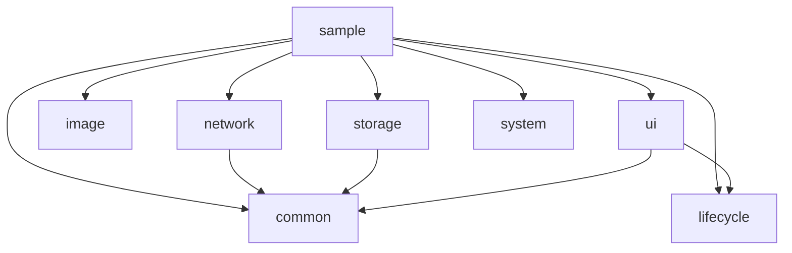

# 架构设计

## 分类索引

| 分类 | 章节入口 | 内容 |
| --- | --- | --- |
| 模块边界 | [依赖方向](#依赖方向) | 模块依赖图、api 与 implementation 边界 |
| 分层与状态 | [MVVM + Repository](#mvvm--repository) | UI → ViewModel → Repository 数据链路 |
| 生命周期与线程 | [生命周期和线程](#生命周期和线程) | Binding、任务取消、回调与 IO 归属 |
| 请求与主题 | [请求 Base 与公共颜色](#请求-base-与公共颜色) | 请求状态和页面状态分离、主题资源归属 |
| 网络行为 | [网络安全与扩展](#网络安全与扩展) | 同源凭证、日志、重试、刷新与流式传输 |
| 数据生命周期 | [缓存与迁移](#缓存与迁移) | LRU/TTL、用户隔离、持久化和 Room 迁移 |
| 加载控件 | [LoadingTextView](#loadingtextview) | 显示、点击、动画与请求的责任边界 |
| 图片与页面 | [图片与 UI](#图片与-ui) | Glide Target、列表回收、文案和官方系统入口 |

## 依赖方向

图中箭头表示“依赖”。没有 core 到 sample 或具体账号/商品/播放业务的依赖，也没有循环依赖。每个模块独立 Android Library，依赖通过 `api`（公开类型）和 `implementation`（内部细节）区分。Glide、Retrofit、Room、AndroidX 类型在相应模块 API 中明确暴露，避免重新设计第三方完整框架。

## MVVM + Repository

`DemoFragment.java → DemoViewModel.kt → DemoRepository.kt → Retrofit/Room/MMKV`。

Sample 目录已按 view/activity、view/fragment、view/adapter、viewmodel、model/api、model/entity、model/repository 与 worker 分层。Binding 创建通过 `super(XxxBinding::inflate)` 交给 BaseActivity/BaseFragment，保留自定义 inflateBinding 兼容入口；完整结构与系统重建约定见 [MVVM](MVVM.md)。

Java UI 观察 LiveData，不操作 Continuation 或 Flow。Kotlin ViewModel 通过 viewModelScope 管理请求；Repository 做数据源组合与持久化；BaseViewModel 只暴露页面状态和独立请求繁忙状态。BaseActivity/Fragment 只管理 ViewBinding，没有网络、图片、数据库父类方法。

Sample 的页面状态和列表数据分开存放。有内容的网络失败保留列表并发出本地化 Snackbar；首次失败显示 Error。Empty/Error 按钮仅演示 UI 状态，重试恢复本地 Room 数据。业务错误的技术 code 不能直接作为用户文案。

## 生命周期和线程

- Activity Binding 跟随 Activity 实例；Fragment Binding 在 onDestroyView 置空，之后访问明确失败。
- Fragment 的 LiveData 观察者、网络回调使用 ViewLifecycleOwner，而非 Fragment 本身。
- viewModelScope 请求在 ViewModel 清理时取消。DemoViewModel 的有限 IO 清理协程等待整个 ViewModel scope（含已取消的旧请求）退出后关闭数据库，避免关闭仍在执行的查询；不保存 UI Context。
- JavaRequests 以 Main dispatcher 投递回调，在 owner 销毁或 CancelHandle.cancel 时取消 Retrofit Call。请求完成时移除 observer。
- LifecycleTasks.launchIo 使用 runInterruptible 运行 Java Runnable。不能中断的第三方阻塞 API 仍须其自身取消接口，不能宣称生命周期能强制终止任意工作。
- MMKV 初始化只取 applicationContext；Room、图片磁盘缓存、文件清理使用 IO/显式 Executor。前后台观察者只持有 ProcessLifecycleOwner。
- NetworkStatus.observe 的监听可能捕获页面，因此调用者必须关闭订阅；实现关闭后抑制排队的回调。

## 请求 Base 与公共颜色

BaseResponse 是可选的 code/message/data 服务端模型，BaseRequest 是生命周期 scope 内的单请求通道。BaseRequest 同实例最新请求优先，错误转换与取消分别处理，通过 LiveData 暴露独立 RequestState，避免在请求层硬编码页面 Loading。DemoViewModel 使用它驱动 requestBusy，页面 Content/Empty/Error 仍由业务决定。服务器成功码可配置，缺少 code/data 明确视为格式问题。详见 [REQUEST_BASE.md](REQUEST_BASE.md)。

core:ui 的 colors.xml/values-night/colors.xml 提供语义色及深色覆盖，Theme.BaseKit 映射默认文字/背景和 Material 色。Sample 已使用该主题与标题/正文/图片占位色。App 可覆盖同名资源，或者在原主题中自行映射；不缓存解析后的颜色整数。详见 [COLORS.md](COLORS.md)。

## 网络安全与扩展

配置 URL、超时、Header 和 TokenProvider。Header 配置复制为快照，框架凭证仅发送到 base URL 的 scheme/host/port。同源判定之外的初始请求和重定向都剥离框架 Header/Authorization。

日志采取白名单，只输出 HTTP method/status/costMs；不会输出 URI 路径、Query、Header、Body 或异常对象。默认不开启，在 Release 中 Sample 不种植 Timber.DebugTree。业务自行添加的日志仍由业务负责。

重试默认 0，最多 5；只对可重放 GET/HEAD/PUT/DELETE/OPTIONS 的连接 IOException 和 502/503/504 进行有限退避。POST、一次性和 duplex Body 不重试。401 刷新同样只重放可重放的幂等请求；非幂等请求由业务处理。callTimeout 约束整个调用。取消单独传播；HTTP/解析/超时/网络/业务错误返回 AppError。

Authenticator 按 NetworkClient 实例串行刷新。同批失败会检查 Provider 中已更新的 Token，避免重复刷新；失败 Token 冷却 5 秒。刷新最多一次重放。TokenRefresher 必须通过独立、无此 Authenticator 的 client 刷新，并在返回前原子写入新 Token。不同 client 实例间的刷新协调、多账号路由、主动登出由账号业务管理。

上传/下载 Progress 包装 Okio 流，不缓存整个大文件。回调在 IO 线程，业务负责节流/切 Main；未知长度为 -1，完成以 EOF/写入结束判断。流式下载请在 Retrofit 方法上使用 @Streaming，并 use/close 响应体。

## 缓存与迁移

MemoryCache 是线程安全 LRU，容量按条目数量，默认单调时钟，TTL=0 永久缓存，过期自动删除。每个用户创建独立缓存实例，不共享跨账号结果。

PreferencesCacheStore 用独立 MMKV namespace 保存字符串和 expiresAt，绝不清除同用户设置 namespace。持久 TTL 用墙钟，系统时钟调整可能影响失效时间。用户退出时，取消其任务后逐项清除用户 preferences/cache/Room；Sample Repository 提供 logout 示例，实际账号生命周期要由业务接入。MMKV SINGLE_PROCESS_MODE 适用于单进程 App，多个进程共享应明确改变模式。KV 与缓存未做密码学加密，不用于存储 Token 等敏感凭证。

CachedRepository 明确执行 CACHE_FIRST/NETWORK_FIRST/NETWORK_ONLY。缓存读写异常通过 onCacheError 报告，不覆盖已成功的网络结果；取消不回退缓存。只把业务允许的可缓存数据放入它。

Room DemoDatabase version=2，MIGRATION_1_2 在已有表添加 updatedAt，默认值 0，保留旧数据；未配置 destructive migration。2.json 由 KSP 实际导出。迁移测试创建真实 v1 SQLite 表，再以 Room v2 打开并验证数据/schema。商业 App 的 Room 数据库应建立自己的 entities/migrations，不把示例表作为全业务数据库。

## LoadingTextView

点击加载控件复用 AndroidX CircularProgressDrawable，只管理显示/点击/动画生命周期，不保存请求或全局 Context。自动模式进入 Loading 后调用官方 OnClickListener；由 ViewModel 驱动时关闭自动模式以保持单一状态来源。Sample 绑定 requestBusy，失败或取消也会恢复。控件停止动画而不擅自取消 ViewModel 任务，Fragment View 销毁仍由原生命周期观察规则处理。见 [LOADING_TEXTVIEW.md](LOADING_TEXTVIEW.md)。

## 图片与 UI

ImageLoader 利用 Glide.with(view)、请求等价判定、内存/磁盘缓存和 Target 生命周期，不保存 URL Tag 或 Bitmap 缓存。使用 dontAnimate 避免每次普通绑定添加过渡；圆角保持所选缩放顺序。RecyclerView 回收时通过 Application RequestManager 清除现有 Target（Glide 转交所属 manager），允许 Activity 已销毁时的回收，不创建新 View 请求；相同 URL 的缓存签名刷新应直接使用 Glide 的 Signature API，而不是修改 Base 全局状态。

页面文案在 strings.xml，默认英文和中文示例。UI 状态组件按资源 ID 展示本地化错误，网络层不依赖 UI。新页面结果使用 Activity Result API。Navigation Component、权限结果和 Intent 沿用官方类型，仅提供少量 Java 静态入口。
